<!-- ===================================================================== -->
<!--  README de perfil — github.com/caiquegomesdev                          -->
<!--  Cards de stats/pins/snake são gerados pelo workflow em                -->
<!--  .github/workflows/profile-cards.yml e salvos em /profile               -->
<!-- ===================================================================== -->

<div align="center">



<a href="https://git.io/typing-svg">
  
</a>

<br/>

<a href="https://www.linkedin.com/in/ca%C3%ADque-gomes-0a1706176/"></a>
<a href="https://caiquegomesdev.github.io/CaiqueGomesDevPortifolio-/"></a>
<a href="mailto:caiquegomesdev@gmail.com"></a>
<a href="https://instagram.com/caizx__"></a>


</div>

---

## 👨‍💻 Sobre mim

Sou **desenvolvedor Full Stack, Mobile e Back-end** em Salvador‑BA. No dia a dia trabalho em **operação real**: sistemas em produção, ERP, banco de dados e integrações que movimentam compras, vendas, estoque e financeiro de uma empresa. Gosto de transformar processo manual em **automação**, dado solto em **dashboard** e problema recorrente em **sistema**.

```ts
const caique = {
  nome: "Caíque Santos Gomes",
  local: "Salvador - BA, Brasil 🇧🇷",
  atuacao: ["Full Stack", "Mobile", "Back-end"],
  empresa: "Terwal Máquinas",
  formacao: [
    "Análise e Desenvolvimento de Sistemas",
    "Técnico em Automação Industrial — SENAI",
  ],
  stackPrincipal: ["TypeScript", "Node.js", "NestJS", "React", "Next.js", "React Native"],
  dados: ["PostgreSQL", "Oracle", "MySQL", "Redis"],
  foco: ["ERP Sankhya", "Integrações", "Dashboards", "IA aplicada a processos"],
  lema: "AVANTE 🦅",
};
```

## ⚡ O que eu faço hoje

<table>
  <tr>
    <td width="33%" valign="top">
      <h3>🧠 Back-end & Integrações</h3>
      <ul>
        <li>APIs REST com <b>Node.js / NestJS</b></li>
        <li>Integrações entre <b>ERP ↔ sistemas</b></li>
        <li>Filas, cache e tempo real (Redis, WebSockets)</li>
        <li>Autenticação segura e controle de acesso</li>
      </ul>
    </td>
    <td width="33%" valign="top">
      <h3>🎨 Front-end & Mobile</h3>
      <ul>
        <li>Apps web com <b>React / Next.js</b></li>
        <li>UI com <b>Tailwind</b> + <b>shadcn/ui</b></li>
        <li>Apps mobile com <b>React Native</b></li>
        <li>Dashboards interativos e responsivos</li>
      </ul>
    </td>
    <td width="33%" valign="top">
      <h3>📊 ERP, Dados & IA</h3>
      <ul>
        <li>Dashboards e customizações no <b>Sankhya ERP</b></li>
        <li><b>Oracle SQL</b> e relatórios <b>JasperReports</b></li>
        <li>Automação de processos e validação de XML</li>
        <li>Chatbots e <b>IA aplicada</b> (RAG, LLM local)</li>
      </ul>
    </td>
  </tr>
</table>

## 🛠️ Tech Stack

<div align="center">

| | Tecnologias |
|:--|:--|
| **Linguagens** |  |
| **Front-end & Mobile** |  |
| **Back-end** |  |
| **Banco de dados** |   |
| **DevOps & Cloud** |  |
| **Ferramentas** |  |


</div>

## 🚀 Projetos em destaque

<div align="center">

<a href="https://github.com/caiquegomesdev/SalesWebMvc"></a>
<a href="https://github.com/caiquegomesdev/Vyear"></a>
<a href="https://github.com/caiquegomesdev/Financing-Simulator"></a>
<a href="https://github.com/caiquegomesdev/CaiqueGomesDevPortifolio-"></a>

</div>

| Projeto | O que é | Stack |
|:--|:--|:--|
| 🔐 **OpenDoor** | Controle de acesso escolar com RFID — TCC | Node.js · MySQL · ESP32 |
| 🌐 **Portfólio** | Site single-file com canvas 3D, terminal funcional, temas e API do GitHub ao vivo | HTML · CSS · JavaScript |
| 💼 **SalesWebMvc** | Sistema web de vendas com ASP.NET Core MVC | C# · .NET · Entity Framework |
| 🚗 **Vyear** | Consulta de dados de veículo (modelo, marca, ano) pela placa | JavaScript |

## 📈 GitHub Stats

<div align="center">





<br/><br/>

<picture>
  <source media="(prefers-color-scheme: dark)" srcset="./profile/snake-dark.svg" />
  <source media="(prefers-color-scheme: light)" srcset="./profile/snake.svg" />
  
</picture>

</div>

## 🤝 Vamos conversar?

Curto trocar ideia sobre **ERP, integrações, automação, arquitetura de sistemas e IA aplicada**. Se você tem um projeto, vaga ou desafio técnico, me chama:

<div align="center">

<a href="https://www.linkedin.com/in/ca%C3%ADque-gomes-0a1706176/"></a>
<a href="mailto:caiquegomesdev@gmail.com"></a>
<a href="https://caiquegomesdev.github.io/CaiqueGomesDevPortifolio-/"></a>

</div>

<details>
<summary><b>🇺🇸 English summary</b></summary>
<br/>

Hi! I'm **Caíque Gomes**, a **Full Stack, Mobile & Back-end Developer** from Salvador, Brazil. I build production systems with **TypeScript, Node.js/NestJS, React/Next.js and React Native**, backed by **PostgreSQL, Oracle and Redis**, running on **Docker**. At work I specialize in the **Sankhya ERP** ecosystem — Oracle SQL, custom dashboards, JasperReports and system integrations — and in applying **AI to business processes** (chatbots, RAG, local LLMs). I'm currently studying Systems Analysis & Development and Industrial Automation. Feel free to reach out on LinkedIn or by email.

</details>

<br/>


